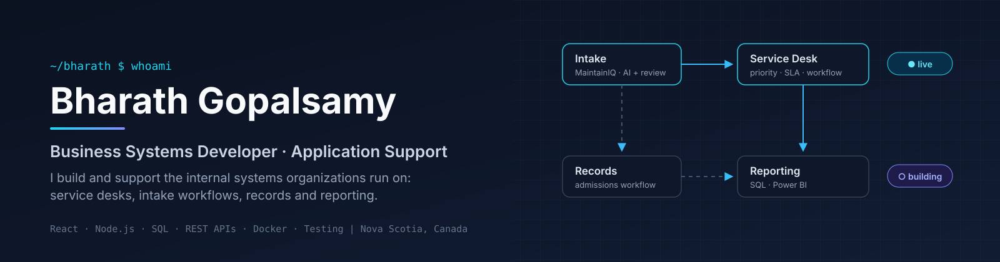
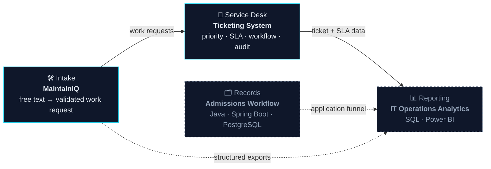

  

  
  
  
  

  
  
  

---

### The problem space I work in

Most of what keeps an organization running isn't its public website. It's the **internal systems** behind it: the service desk that triages a broken laptop, the form that turns a maintenance report into a work order, the records system an admissions team lives in, and the reports a manager reads on Monday.

That's where my experience sits:

- **Building** those systems: React interfaces, Node.js/Express APIs, SQL data models, validation and tests.
- **Supporting** them: investigating defects, tracing API and state issues, regression checks, documenting fixes.
- **Using** them: I currently process applications and keep records accurate in a Salesforce-based CRM (TargetX) at StFX Admissions.

I'm looking for full-time roles as a **junior software developer, application / IT support analyst, or business systems analyst**.

---

### Systems map

My flagship projects are designed as parts of one operations platform. Each one is a complete, tested application on its own.

Solid = built and on GitHub · dashed = on the roadmap

---

### Flagship projects

<table>
  <tr>
    <td width="50%" valign="top">
      <h4>🎫 Service Desk Ticketing System</h4>
      
      
IT service desk modelled on how internal support teams handle incidents.

      <ul>
        <li>ITIL-style <b>impact × urgency → P1–P4</b> priority</li>
        <li>Response and resolution <b>SLA deadlines</b> with breach detection</li>
        <li>Server-enforced ticket <b>workflow</b> and full <b>audit trail</b></li>
        <li>SQL <b>reporting</b>: SLA compliance, breaches, resolution time</li>
        <li>39 automated tests · CI · Docker</li>
      </ul>
      
<code>React</code> <code>Node.js</code> <code>Express</code> <code>SQLite</code> <code>Zod</code> <code>Vitest</code> <code>Docker</code>

      
<a href="https://service-desk-ticketing-system.onrender.com"><b>Live demo</b></a> · <a href="https://github.com/bharathgopalswamy/service-desk-ticketing-system"><b>Source</b></a> · <a href="https://github.com/bharathgopalswamy/service-desk-ticketing-system/blob/main/docs/ARCHITECTURE.md"><b>Architecture</b></a>

    </td>
    <td width="50%" valign="top">
      <h4>🛠️ MaintainIQ Intake</h4>
      
Turns plain-language maintenance reports into structured CMMS work requests. A person reviews every field before anything is submitted.

      <ul>
        <li>Gemini extraction validated against a <b>Zod schema</b>; unknown fields stay blank and are flagged, never invented</li>
        <li>Deterministic <b>safety rules</b> (gas, fire, electrical) escalate priority independently of the AI</li>
        <li>Safe error handling: internal details are logged, not shown to users</li>
        <li>Automated tests · CI · Docker</li>
      </ul>
      
<code>React</code> <code>Express</code> <code>Gemini API</code> <code>Zod</code> <code>Vitest</code> <code>Docker</code>

      
<a href="https://github.com/bharathgopalswamy/maintainiq-intake"><b>Source</b></a>

    </td>
  </tr>
</table>

  
<b>More projects</b> (data, full-stack, analytics)

   

| Project | What it shows | Stack | Links |
|---|---|---|---|
| **Job Market Reality Check** | Analysis of 2,253 data-analyst postings: skill demand with SQL (joins, CTEs, window functions) | Python · SQL · MySQL · Power BI | [Source](https://github.com/bharathgopalswamy/job-market-reality-check) |
| **Spotify Music Intelligence** | API → ETL → normalized MySQL → Power BI pipeline (10 albums, 124 tracks) | Python · Spotipy · MySQL · Power BI | [Demo](https://spotify-music-intelligence-platform.vercel.app) · [Source](https://github.com/bharathgopalswamy/Spotify-Music-Intelligence-Platform) |
| **DermaCure** | Role-based patient / doctor / admin workflows with JWT auth (portfolio prototype, not clinically validated) | React · Node.js · MongoDB · Docker | [Demo](https://derma-ai-psi.vercel.app) · [Source](https://github.com/bharathgopalswamy/DermaAI) |
| **HabitIQ** | TypeScript full-stack app with analytics dashboards and optional AI planning | React · TypeScript · Node.js · MongoDB | [Demo](https://habitiq-blond.vercel.app) · [Source](https://github.com/bharathgopalswamy/smart-ai-habit-tracker) |

---

### Experience

| Role | Where | What I do / did |
|---|---|---|
| **Admissions Assistant** | St. Francis Xavier University | Process applications and maintain applicant records in TargetX CRM; Excel reporting and data-quality checks |
| **Website Coordinator & Technical Support** | StFX | Improved a page's PageSpeed score from 32 to 93; fixed broken links and layout defects with DevTools; desktop/mobile QA |
| **Software Developer** | FirstLanguage Technologies | React + TypeScript features on REST APIs; defect investigation; functional and regression testing |
| **Frontend Developer Intern** | FirstLanguage Technologies | Reusable dashboard components with Context and custom hooks; API/state defect tracing |
| **ReactJS Developer Intern** | Banao Technologies | Wireframes → responsive forms, tables and dashboards; REST API integration |

---

### How I build

- **Tests first-class:** business rules (priority, SLA, workflow) are unit-tested; APIs are tested end to end with Supertest; UIs with React Testing Library.
- **CI on every change:** lint → tests → build → Docker build and smoke test, via GitHub Actions.
- **Decisions written down:** each flagship has an `ARCHITECTURE.md` (diagrams, data model, trade-offs) and a `DEVLOG.md`.
- **Validate on the server, guide in the UI:** the client only offers valid actions; the API still enforces them.
- **Open about tooling:** I use AI pair-programming (Claude Code) on portfolio projects. I define the requirements, review every pull request, and can explain every design decision.

---

### Toolbox

  

| Area | Tools |
|---|---|
| Application development | React, TypeScript, JavaScript, Node.js, Express, REST APIs, Zod |
| Data and reporting | SQL, MySQL, SQLite, MongoDB, Python, Excel, Power BI |
| Quality | Vitest, Jest, React Testing Library, Supertest, Postman, regression testing |
| Delivery | Git, GitHub Actions, Docker, Vercel, Render |
| Business systems | TargetX CRM (Salesforce-based), ITIL fundamentals, Microsoft Teams, SharePoint |

---

### Now building

- [ ] **Service Desk v0.3:** SLA clock pauses while On Hold · logins with requester / agent / lead roles · business-hours SLA
- [ ] **Admissions Application Workflow System:** Java 21, Spring Boot, PostgreSQL, JUnit; fictional data only
- [ ] **IT Operations Analytics:** a SQL star schema and Power BI report over the Service Desk and MaintainIQ data

---

<picture>
  <source media="(prefers-color-scheme: dark)" srcset="https://raw.githubusercontent.com/bharathgopalswamy/bharathgopalswamy/output/github-contribution-grid-snake-dark.svg" />
  <source media="(prefers-color-scheme: light)" srcset="https://raw.githubusercontent.com/bharathgopalswamy/bharathgopalswamy/output/github-contribution-grid-snake.svg" />
  
</picture>

  Based in Nova Scotia · open to Atlantic Canada, remote within Canada, and relocation for the right role

